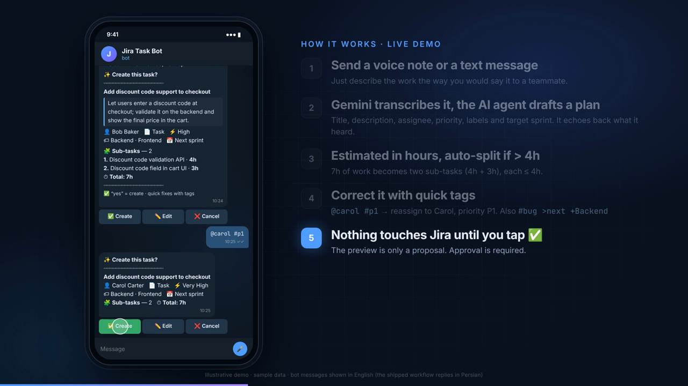

# بات تلگرام ← جیرا (ساخت تسک با هوش مصنوعی)

[English README](README.md)

یک ورک‌فلوی [n8n](https://n8n.io) که یک پیام کوتاه فارسی (متن **یا وویس**) را به یک تسک کامل در Jira تبدیل می‌کند: عنوان انگلیسی، توضیح فارسی، تخمین زمان به ساعت، و شکستن خودکار تسک‌های بزرگ به ساب‌تسک. تسک فقط **بعد از تایید شما** ساخته می‌شود.

> ▶ برای دیدن ویدیوی دمو (انگلیسی) روی تصویر کلیک کنید. دمو و اسکرین‌شات‌ها با **داده‌ی نمونه** ساخته شده‌اند و بات واقعی فارسی پاسخ می‌دهد.

## قابلیت‌ها

- **ساخت تسک از متن آزاد فارسی**: عنوان انگلیسی، توضیح فارسی، نوع (Task/Bug)، اولویت، مسئول، لیبل و اسپرینت مقصد
- **تخمین زمان**: تخمین به ساعت؛ بیشتر از ۴ ساعت به ساب‌تسک‌های حداکثر ۴ ساعته تقسیم می‌شود
- **تایید قبل از ساخت**: ابتدا کارت پیش‌نمایش نشان داده می‌شود و تا تایید نکنید چیزی در Jira ساخته نمی‌شود
- **وویس**: وویس با Gemini به متن تبدیل می‌شود و بات می‌گوید «شنیدم: …»
- **تگ‌های سریع**: `#bug` `#p1` `@alice` `>next` `>35` `+Backend`
- **اسپرینت و وضعیت**: «ببرش به اسپرینت بعدی»، «این تموم شد»
- **گزارش‌ها**: وضعیت اسپرینت، بار کاری هر نفر، فعالیت N روز گذشته، تسک‌های من، جست‌وجو، و سوال آزاد (تبدیل به JQL فقط‌خواندنی)
- **ثبت زمان** با Tempo، **ضمیمه کردن عکس/فایل** به تسک
- **نقش‌ها**: `admin`، `lead`، `member`، `guest`؛ کاربران ناشناس مهمان هستند و درخواستشان باید توسط مدیر تایید شود
- **حالت راهنما (Wizard)** برای ساخت تسک با دکمه، قدم‌به‌قدم

## معماری

مدل زبانی فقط یک «طرح» (JSON) برمی‌گرداند و هیچ‌چیز را خودش در Jira نمی‌نویسد. اعتبارسنجی و فراخوانی API توسط نودهای Code قطعی انجام می‌شود و بعد از تایید کاربر اجرا می‌شود.

## راه‌اندازی

۱. فایل `workflow/telegram-jira-task-bot.json` را در n8n وارد (Import) کنید.
۲. سه Credential بسازید: توکن بات تلگرام، کلید Gemini، و Header Auth برای Jira (`Authorization: Bearer <PAT>`).
۳. مقادیر نمونه را طبق [`docs/configuration.md`](docs/configuration.md) عوض کنید (آدرس Jira، کلید پروژه، شناسه‌ی برد، شناسه‌ی انواع issue، اعضای تیم، آیدی تلگرام مدیر، کد عضویت مهمان).
۴. ورک‌فلو را فعال کنید و به بات پیام بدهید.

## نکته‌های امنیتی و محدودیت‌ها

- این ریپو هیچ توکن یا رمزی ندارد؛ همه‌ی نام‌ها، شناسه‌ها، دامنه و کلید پروژه placeholder هستند.
- برای Jira از توکنی با حداقل دسترسی لازم استفاده کنید.
- پیام‌ها و پرامپت‌ها فارسی‌محورند. برای Jira Server/Data Center نوشته شده و برای Jira Cloud باید چند نود تغییر کند.
- تخمین‌ها از یک مدل زبانی می‌آیند و جایگزین تاریخچه‌ی واقعی تیم نیستند.

## لایسنس

MIT

