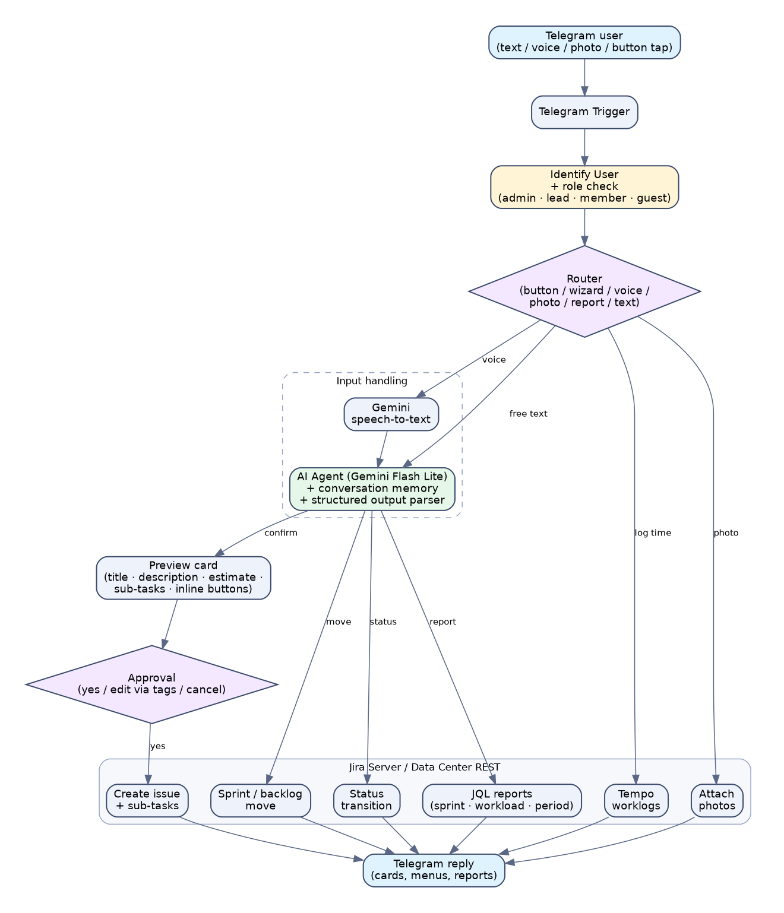

# Telegram → Jira AI Task Bot

[فارسی](README.fa.md) · English

> Turn a short Persian message (text **or voice**) into a well-formed Jira issue — with an English title, a Persian description, an hour estimate, and automatic sub-task splitting — after you approve a preview in Telegram.

An [n8n](https://n8n.io) workflow that puts an AI project assistant inside a Telegram chat. Built for a Persian-speaking product owner who wanted to create and manage Jira tickets from a phone in seconds, without opening Jira.

https://github.com/user-attachments/assets/86470e46-313f-4485-92c5-ae30ce4e1831

> The demo and screenshots use **sample data** and are illustrative, not a real team's Jira. The video is in English; the shipped bot replies in Persian.

## What it does

| Area | Capability |
|---|---|
| **Task creation** | Free-form Persian text → structured issue: English summary, Persian description, issue type, priority, assignee, labels, sprint target |
| **Estimation** | AI estimates in hours (1–6 h per item). Anything over 4 h is split into sub-tasks of ≤ 4 h each |
| **Safety** | A preview card is shown first. **Nothing is created until you tap approve.** You can correct the plan with a follow-up message or quick tags |
| **Voice** | Voice notes are transcribed with Gemini, shown back to you ("I heard: …"), then handled like text |
| **Quick tags** | `#bug` `#task` · `#urgent` `#p1`…`#p5` · `@alice` · `>next` `>35` `>backlog` · `+Backend` `-Frontend` |
| **Sprint & status** | "Move it to next sprint", "mark it done", "put it on testing" — executed against Jira after the agent classifies the intent |
| **Reports** | Sprint overview, per-person workload, last-N-days activity, "my tasks", search, and free-form questions answered via generated read-only JQL |
| **Time tracking** | Log work from Telegram via Tempo Timesheets, with button keypads for durations |
| **Attachments** | Send a photo/file and attach it to an issue |
| **Access control** | Roles (`admin`, `lead`, `member`, `guest`). Unknown users become guests: their requests are forwarded to the admin and only reach Jira after approval |
| **Guided mode** | A step-by-step wizard (assignee → label → priority → sprint → estimate) for people who prefer buttons over typing |

## How it works



1. **Telegram Trigger** receives messages and button taps.
2. **Identify User** maps the Telegram user ID to a role and Jira identity.
3. A router sends the update to the right branch: button, wizard, voice, photo, report, or free text.
4. **Review And Estimate** is an n8n AI Agent (Gemini Flash Lite) with conversation memory and a structured-output parser. It never writes to Jira; it only returns a JSON plan with one of five actions: `ask`, `confirm`, `report`, `move`, `status`.
5. Deterministic Code nodes validate the plan, build the Jira payloads, and call the Jira REST API. The LLM is deliberately kept out of the write path.

Keeping the model limited to "produce a plan" and everything else deterministic and approval-gated is the core design decision of this project.

## Requirements

- n8n (self-hosted or cloud) with the **AI / LangChain nodes** available
- A Telegram bot token from [@BotFather](https://t.me/BotFather)
- A Google Gemini API key
- **Jira Server / Data Center** reachable from n8n, with a personal access token
  (the workflow uses `/rest/api/2` and `/rest/agile/1.0`)
- *(Optional)* Tempo Timesheets for worklog features

## Setup

1. **Import** `workflow/telegram-jira-task-bot.json` into n8n.
2. **Create three credentials** and attach them to the nodes that ask for them:
   - *Telegram API* → your bot token
   - *Google Gemini (PaLM) API* → your API key
   - *Header Auth* → `Authorization: Bearer <your-jira-PAT>`
3. **Replace the placeholders** listed in [`docs/configuration.md`](docs/configuration.md): Jira URL, project key, board ID, issue-type IDs, team members, admin Telegram ID, and the guest join code.
4. **Activate** the workflow and message your bot.

Full details and the list of nodes to edit are in [`docs/configuration.md`](docs/configuration.md).

## Security notes

- This repository contains **no credentials**. Tokens live in n8n's credential store and are not part of the exported JSON.
- Only users listed in the `USERS` map get a role. Everyone else is a *guest* and can only submit requests that the admin must approve. (See the `viewer` note in `docs/configuration.md`.)
- Use a Jira token with the minimum permissions you need (create/edit issues, browse, optionally worklogs).
- The AI is prompted to emit **search-only JQL** for reports, but you should still use a token that cannot delete or administer anything.
- All identifiers in the shipped JSON (names, IDs, domain, project key) are placeholders. Do not commit your real values back.

## Known limitations

- The prompt, menus and messages are **Persian-first**. The structure is language-agnostic, but you will need to translate the strings for other languages.
- Written for Jira Server/Data Center. Jira Cloud uses account IDs and different Tempo endpoints, so those nodes would need changes.
- Estimates come from an LLM with a calibration prompt, not from your team's history. Treat them as a starting point.
- Issue-type and priority IDs are instance-specific and must be looked up in your Jira.

## Repository layout

```
workflow/   n8n workflow export (sanitized)
docs/       configuration guide
assets/     architecture diagram, screenshots, demo video + poster
scripts/    check_no_secrets.py: leak check to run before every push
```

## License

MIT — see [LICENSE](LICENSE).

## Contributing / before you push changes

Keep a git-ignored `config.private.json` with your real values and run `python3 scripts/check_no_secrets.py` before every commit. It fails if any of them (or anything that looks like a Telegram ID, token or `JIRAUSER` key) appears in a tracked file.
